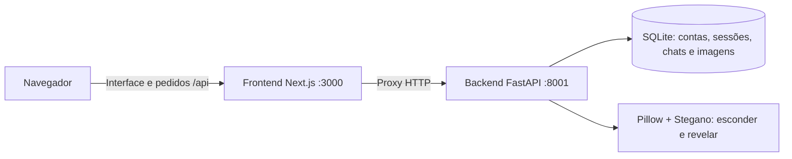
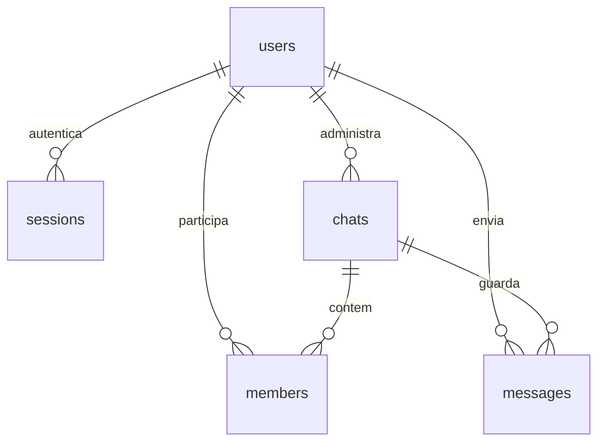

# Arquitetura e explicação do StegChat

## Duas camadas

O frontend é responsável pela apresentação e interação. O backend valida os pedidos, identifica a conta, verifica permissões e grava os dados. A interface não acede diretamente à base de dados e não decide quem tem autorização para ler ou alterar uma mensagem.

O Next.js encaminha `/api/...` para a API. O navegador usa sempre o mesmo endereço da interface, incluindo nas imagens. Assim, o cookie de sessão acompanha os pedidos sem guardar tokens em `localStorage` ou configurar pedidos entre origens diferentes no navegador.

## Frontend

### `app/layout.tsx` e `app/globals.css`

`RootLayout` define o HTML base, idioma português e metadados. O CSS define cores, espaçamentos, botões, balões de mensagens, autenticação e janelas modais. As media queries adaptam o chat ao telemóvel: a lista de conversas e a conversa aberta alternam entre ecrãs. Há estilos de foco de teclado e suporte à preferência por reduzir movimento.

### `lib/api.ts`

- `User`, `Chat` e `Message` descrevem a estrutura dos dados recebidos.
- `ApiError` transporta o texto do erro e o código HTTP.
- `api<T>()` chama `fetch`, acrescenta `/api`, envia cookies da mesma origem e impede cache. Acrescenta `Content-Type: application/json` apenas quando o corpo não é `FormData`, para que o navegador construa corretamente os pedidos multipart com imagens.
- Respostas de erro são convertidas em mensagens que a interface pode apresentar.
- `title()` encontra o nome do grupo ou da outra pessoa numa conversa privada.
- `initials()` obtém as iniciais usadas nos avatares.

### `lib/text-file.ts`: associar um TXT sem apresentar o conteúdo

`validateTextFile()` verifica apenas extensão, tamanho máximo de 64 KB e tamanho diferente de zero. Não chama `File.text()`, `arrayBuffer()` ou qualquer outro mecanismo de leitura no navegador.

Na página, `attachText()` guarda o objeto `File` em `textFile` e apresenta apenas o nome. Quando existe um TXT associado, a caixa de escrita é substituída por uma indicação de envio direto. Um rascunho manual só é descartado após confirmação. `send()` envia `kind=hidden`, `image` e `text_file` como multipart, sem incluir `body`. Remover o ficheiro permite voltar à escrita manual. O envio não revela automaticamente a mensagem no remetente ou no destinatário.

O backend lê o TXT através de `text_files.read_text_file()`, verifica extensão, tamanho, UTF-8 e limite de 10 000 caracteres, rejeitando conteúdo vazio ou binário. Remove o BOM UTF-8 e preserva quebras de linha e acentos. O conteúdo é passado diretamente à esteganografia e não é devolvido na resposta do envio nem no histórico; só é extraído por uma ação explícita de revelar/editar. O schema da base de dados mantém-se.

### `components/Auth.tsx`

Apresenta os formulários de registo e entrada. `submit()` recolhe os campos, envia JSON para o endpoint correspondente e entrega a conta autenticada a `onLogin`. O botão é desativado durante o pedido e os erros são mostrados junto ao formulário. Os campos têm limites, preenchimento automático e validação HTML; o backend repete a validação.

### `components/Modal.tsx` e `Icon.tsx`

`Modal` usa o elemento nativo `<dialog>` com `showModal()`, mantém o foco dentro da janela e permite fechar com Escape. `Icon` centraliza ícones SVG locais; não existe dependência de uma biblioteca externa de ícones ou de imagens remotas.

### `app/page.tsx`

O componente `Home` reúne os estados da aplicação:

| Estado | Finalidade |
| --- | --- |
| `user` | Conta autenticada. Sem conta, apresenta `Auth`. |
| `chats` / `selected` | Conversas disponíveis e identificador da conversa aberta. |
| `messages` | Histórico da conversa selecionada. |
| `body`, `hidden`, `image` | Rascunho, modo de envio e imagem selecionada. |
| `textFile` | Objeto do TXT associado; apenas o nome é apresentado, sem ler o conteúdo no navegador. |
| `editing` | Mensagem que está a ser editada, quando existe. |
| `revealed` | Textos extraídos que o utilizador escolheu mostrar. |
| `panel` | Janela aberta: nova conversa, criar grupo, gerir grupo ou revelar ficheiro. |
| `search`, `results`, `memberIds` | Pesquisa e seleção de participantes. |
| `busy`, `error`, `connection` | Estado das operações, erros e ligação ao servidor. |
| `revision` | Solicita uma atualização imediata depois de uma alteração. |

Principais funções:

| Função | Comportamento |
| --- | --- |
| `initialize` | Consulta `/auth/me` para recuperar a sessão ao abrir/recarregar a página. |
| `sync`, dentro do efeito | Carrega conversas e mensagens; marca como lidas as mensagens recebidas quando a página está visível; agenda a próxima atualização após 3 segundos. |
| `resetComposer` | Limpa texto, ficheiro e modo de edição. |
| `selectChat` | Muda de conversa e pede confirmação antes de descartar um rascunho. |
| `openPanel` | Abre e inicializa a janela apropriada. |
| `modalAction` | Centraliza os estados de espera/erro nas operações das janelas. |
| `startDirect` | Pede uma conversa com o utilizador selecionado e abre-a. |
| `createGroup` | Envia nome e IDs dos participantes e abre o grupo criado. |
| `send` | Envia `FormData` para uma nova mensagem ou JSON para editar uma existente. |
| `reveal` | Pede ao backend para extrair o texto da imagem. |
| `edit` | Carrega o texto no editor; se for oculto, revela-o primeiro. |
| `remove` | Pede confirmação e elimina a mensagem para todos. |
| `logout` | Revoga a sessão e limpa o estado privado da interface. |

A pesquisa tem um atraso de 250 ms para evitar um pedido por cada tecla. Os efeitos ignoram respostas antigas quando o utilizador muda de conversa ou fecha a pesquisa. A pré-visualização de uma imagem usa um URL temporário do navegador, libertado quando a imagem muda.

O texto revelado fica associado à versão `edited_at` da mensagem. Se o remetente editar o conteúdo oculto, o texto anterior deixa de ser mostrado e o destinatário precisa de revelar a nova versão. As imagens incluem essa versão no URL e a API proíbe cache.

A rolagem acompanha mensagens novas quando o utilizador já está perto do fim; evita saltar automaticamente enquanto ele lê mensagens antigas. Enter envia e Shift + Enter introduz uma nova linha.

## Backend

### `database.py`

`DB_PATH` usa `CHAT_DB_PATH` ou um caminho padrão junto ao módulo. `initialize()` cria a pasta, ativa WAL e cria o schema se ainda não existir. `PRAGMA user_version = 1` identifica a primeira versão do schema; alterações futuras ao schema exigirão migrações próprias.

`connect()` é um context manager: abre uma ligação SQLite, ativa chaves estrangeiras e configura resultados por nome de coluna. Confirma a transação no sucesso, reverte em caso de exceção e fecha sempre a ligação. Os valores SQL usam parâmetros `?`, evitando concatenar entradas dos utilizadores nas consultas.

`direct_key` identifica um par de utilizadores ordenado, como `1:4`. A restrição `UNIQUE` impede a duplicação de conversas privadas. `members` tem chave composta `(chat_id, user_id)`. A tabela `messages` exige texto sem imagem para o tipo `text`, ou imagem sem texto para o tipo `hidden`.

### `security.py`

- `hash_password()` cria um sal aleatório e aplica `hashlib.scrypt` com parâmetros `n=16384`, `r=8` e `p=1`. Guarda o sal e o hash, não a palavra-passe.
- `verify_password()` recalcula o hash e compara-o com `hmac.compare_digest`.
- `hash_token()` calcula SHA-256 do token de sessão. O token original é aleatório e fica apenas no cookie enviado ao navegador; a base de dados guarda o hash.

### `main.py`: arranque e segurança dos pedidos

- `lifespan()` inicializa a base de dados ao arrancar.
- `protect_requests()` rejeita origens externas não autorizadas em pedidos que alteram estado, verifica o tamanho declarado do pedido e aplica `Cache-Control: no-store` e `X-Content-Type-Options: nosniff`.
- `current_user()` consulta o cookie, calcula o hash e procura uma sessão que ainda não expirou. Caso contrário, responde `401`.
- `throttle()` limita registos e tentativas de entrada a 30 por minuto e endereço visto pela API. O contador reside na memória do processo; atrás do proxy local, várias contas podem partilhar o mesmo limite.
- `session()` cria um token aleatório de 32 bytes, remove sessões expiradas e substitui o token anterior daquele navegador. O cookie é `HttpOnly`, `SameSite=Strict` e opcionalmente `Secure` para HTTPS.
- Os modelos Pydantic (`Credentials`, `Registration`, `GroupChat`, etc.) validam campos e comprimentos.
- `public_user()` expõe apenas ID, username e nome, nunca o hash da palavra-passe.

### Permissões

- `require_member()` verifica se a conta pertence à conversa; retorna `404` quando não existe ou não é acessível.
- `require_owner()` exige que a conta seja administradora do grupo.
- `message_row()` localiza uma mensagem e verifica a participação antes de dar acesso aos seus metadados.
- Editar e eliminar exige também `sender_id == user.id`. Ser administrador de grupo não permite editar mensagens dos outros.
- A imagem nunca é servida por uma pasta pública: a rota verifica a sessão e a participação.

### Contas e conversas

O registo normaliza usernames para minúsculas, verifica o formato e cria imediatamente uma sessão. A entrada compara a palavra-passe com o hash. A saída elimina a sessão do servidor e o cookie do navegador.

A pesquisa utiliza `LIKE` parametrizado, com os caracteres especiais `%`, `_` e `\` escapados, e devolve até 30 resultados, excluindo a própria conta.

A lista de conversas inclui participantes, última mensagem e número de mensagens não lidas. A pré-visualização de uma mensagem oculta contém apenas o seu tipo; o texto não é extraído automaticamente.

Ao sair de um grupo, a associação em `members` é eliminada. Se o administrador saiu, o participante restante com menor ID assume a função. Se não houver participantes, o grupo e as mensagens são eliminados em cascata.

### Mensagens

`send_message()` recebe o tipo e texto manual (`body`) ou um upload TXT (`text_file`), além da imagem para mensagens ocultas. Rejeita TXT no modo normal ou TXT e texto manual em simultâneo. Verifica participação e validade. Para mensagens ocultas, processa a imagem antes de a inserir e volta a verificar a participação antes de gravar.

`edit_message()` permite alterar texto normal ou voltar a incorporar o texto numa imagem existente. Atualiza `edited_at`. `delete_message()` remove a linha, incluindo a imagem. `mark_read()` grava o maior ID apresentado, limitado ao último ID efetivamente existente na conversa.

`message_image()` devolve os bytes PNG com um nome de ficheiro. `reveal_message()` extrai o texto apenas depois de verificar autorização. `reveal_upload()` permite a uma conta autenticada ler um PNG externo sem o guardar numa conversa.

### `steganography.py`

`open_image()` verifica o tamanho em bytes, abre com Pillow, limita a resolução e converte para RGB/RGBA. Preserva o canal alfa quando existe; a biblioteca LSB usa apenas os três canais de cor.

`hide()` transforma o texto em bytes UTF-8 e depois em Base64 ASCII, acrescentando o marcador `STEGCHAT1:`. Este envelope contorna a limitação da codificação padrão da biblioteca Stegano para certos caracteres Unicode. Base64 é apenas uma representação do texto, não encriptação.

Antes de ocultar, calcula o número de bits necessários, incluindo o prefixo de comprimento utilizado pela biblioteca. Cada píxel oferece três bits. Se não couber, devolve uma explicação em vez de guardar uma imagem incompleta. `lsb.hide()` altera os bits menos significativos e o resultado é guardado como PNG.

`reveal()` extrai o conteúdo LSB. Se encontrar o marcador novo, descodifica Base64 e UTF-8. Caso contrário, devolve o texto antigo para compatibilidade. Utiliza `close_file=False` e blocos `with` para controlar corretamente o tempo de vida das imagens.

O frontend envia texto e imagem ao servidor durante a criação; não há encriptação de ponta a ponta. O PNG guardado é o portador da mensagem. A ligação deve usar HTTPS quando a aplicação estiver fora do ambiente local.

### `backup.py`

Aceita um destino opcional, rejeita a substituição de ficheiros existentes e chama `sqlite3.Connection.backup()`. Isso permite obter uma cópia consistente mesmo quando WAL está ativo. O destino padrão inclui data/hora e fica em `backups/`.

## Endpoints da API

Todas as rotas abaixo têm prefixo `/api`. Exceto saúde, registo e entrada, os dados privados exigem sessão; sair revoga o token apresentado, mesmo que já tenha expirado.

| Método | Rota | Finalidade |
| --- | --- | --- |
| GET | `/health` | Verificar que a API responde. |
| POST | `/auth/register` | Criar conta e sessão. |
| POST | `/auth/login` | Entrar. |
| POST | `/auth/logout` | Sair. |
| GET | `/auth/me` | Obter a conta atual. |
| GET | `/users?q=...` | Pesquisar utilizadores. |
| GET | `/chats` | Listar as conversas acessíveis. |
| POST | `/chats/direct` | Obter ou criar conversa privada (`user_id`). |
| POST | `/chats/groups` | Criar grupo (`name`, `member_ids`). |
| PATCH | `/chats/{id}` | Alterar nome do grupo. |
| POST | `/chats/{id}/members` | Adicionar participante (`user_id`). |
| DELETE | `/chats/{id}/members/{user_id}` | Remover participante. |
| POST | `/chats/{id}/leave` | Sair do grupo. |
| GET | `/chats/{id}/messages` | Obter o histórico. |
| POST | `/chats/{id}/messages` | Enviar multipart: `kind`, `body` ou `text_file`; `image` obrigatória no modo oculto. |
| POST | `/chats/{id}/read` | Marcar até `message_id` como lido. |
| PATCH | `/messages/{id}` | Editar o texto (`body`). |
| DELETE | `/messages/{id}` | Eliminar mensagem própria para todos. |
| GET | `/messages/{id}/image` | Obter o PNG protegido. |
| POST | `/messages/{id}/reveal` | Revelar uma mensagem da conversa. |
| POST | `/steganography/reveal` | Revelar um upload de imagem externa. |

`401`: sessão ausente/inválida. `403`: ação sem permissão ou origem bloqueada. `404`: recurso inexistente ou não acessível. `409`: username em uso. `413`: pedido demasiado grande. `422`: dados inválidos. `429`: demasiadas tentativas de autenticação.

## Testes e âmbito

`backend/tests/test_api.py` usa `TestClient` e SQLite temporário para executar pedidos com contas diferentes. Verifica os fluxos e as rejeições de acessos indevidos. Não utiliza a base principal.

`frontend/tests/chat.spec.ts` usa Playwright com duas sessões de navegador independentes. Testa registo, conversas, envio normal e oculto, revelação repetida, edição, eliminação, descarga, grupos, saída, persistência de sessão e apresentação móvel. Os servidores de teste usam portas e uma base de dados próprias.

Esta primeira versão usa polling e histórico completo, apropriados a uma demonstração pequena. O schema tem versão inicial, mas não existe um sistema automático de migrações. Para evoluir o projeto com dados existentes, crie migrações antes de alterar as tabelas.

## Referências oficiais

- [Next.js: instalação e estrutura da aplicação](https://nextjs.org/docs/app/getting-started/installation).
- [FastAPI: formulários e ficheiros](https://fastapi.tiangolo.com/tutorial/request-forms-and-files/).
- [FastAPI: cookies nas respostas](https://fastapi.tiangolo.com/advanced/response-cookies/).

A implementação LSB foi também verificada diretamente no código da versão instalada do Stegano.
