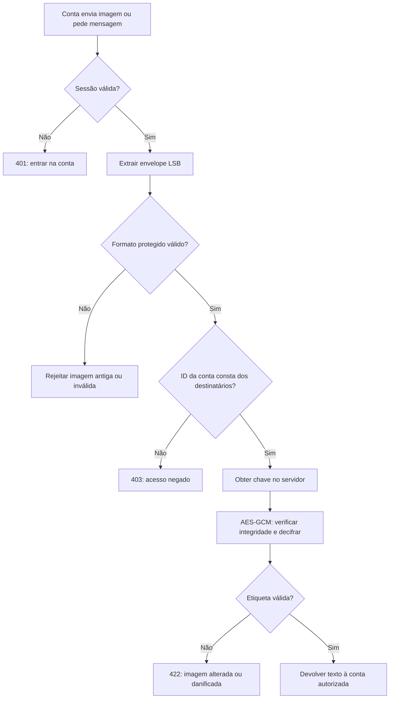
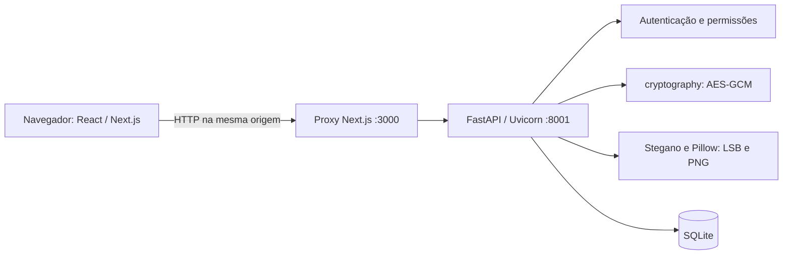

# StegChat — esteganografia, encriptação e controlo de acesso

## 1. Objetivo do projeto

O StegChat é uma aplicação de conversação que permite criar contas, pesquisar utilizadores, trocar mensagens privadas e criar grupos. Além do texto normal, permite ocultar mensagens dentro de imagens. A mensagem pode ser escrita pelo utilizador ou fornecida num ficheiro `.txt`.

A versão atual combina três mecanismos diferentes:

| Mecanismo | Problema que resolve |
| --- | --- |
| Esteganografia LSB | Coloca os dados dentro dos píxeis de uma imagem, com pequenas alterações visuais. |
| Encriptação AES-256-GCM | Impede que alguém com apenas a fotografia consiga ler o texto extraído dos píxeis. |
| Autenticação e autorização | Permite ao servidor entregar o texto apenas às contas destinatárias da mensagem. |

Nas conversas privadas, o remetente e o destinatário são as duas contas autorizadas. Nos grupos, a lista é fixada no momento do envio: inclui o remetente e todos os participantes desse momento. Quem entra no grupo depois não recebe acesso retroativo às mensagens ocultas.

## 2. O que é esteganografia?

Esteganografia é a técnica de esconder informação dentro de outro meio, como uma imagem. Neste projeto, a imagem é o **portador** e a mensagem cifrada é a informação escondida.

Não é o mesmo que encriptação. A esteganografia procura disfarçar a presença dos dados; a encriptação torna os dados incompreensíveis sem uma chave. Uma pessoa pode descobrir que existem dados escondidos e extraí-los, mas ainda assim não conseguir decifrar a mensagem.

### 2.1. Píxeis e componentes de cor

Uma imagem RGB possui três componentes por píxel: vermelho, verde e azul. Numa imagem com oito bits por componente, cada valor varia entre 0 e 255. O valor 202, por exemplo, representa-se como `11001010` em binário.

Numa imagem RGBA existe também o canal alfa, que representa transparência. O método utilizado altera os canais RGB e preserva o alfa.

### 2.2. LSB — Least Significant Bit

O bit menos significativo é o último bit de um número binário. Ao substituir esse bit, o valor de uma componente de cor muda no máximo uma unidade.

```text
Valor original:       202 = 11001010
Bit a guardar:         1
Novo valor:           203 = 11001011
```

Para guardar o bit `0`, uma componente como 101 pode passar a 100. A biblioteca percorre os píxeis sequencialmente e usa um bit de cada componente RGB. Assim, cada píxel oferece três bits para a ocultação.

```text
Um píxel RGB:       [R, G, B]
Bits disponíveis:    1  1  1  → 3 bits
```

A alteração é geralmente pouco percetível, mas não garante invisibilidade a técnicas de análise estatística. O projeto não implementa mecanismos de resistência à esteganálise.

### 2.3. Capacidade da imagem

Uma imagem de largura `W` e altura `H` oferece aproximadamente:

```text
capacidade_em_bits = W × H × 3
capacidade_bruta_em_bytes = floor(W × H × 3 / 8)
```

Numa imagem de 100 × 100 píxeis, são 30 000 bits, ou 3 750 bytes brutos. A mensagem útil ocupa menos: também é necessário guardar o prefixo, o identificador, o nonce, a etiqueta de autenticação, o Base64 e o comprimento utilizado pela biblioteca.

O backend calcula se o envelope completo cabe na imagem antes de a guardar. Caso não caiba, devolve um erro e não cria a mensagem nem uma chave órfã.

### 2.4. Por que guardar em PNG?

O PNG permite preservar os valores dos píxeis produzidos pela ocultação. JPEG utiliza compressão com perdas, que pode modificar os bits necessários para recuperar a mensagem. Por isso, o utilizador pode escolher uma imagem de entrada noutros formatos, mas a imagem resultante é sempre PNG.

Redimensionar, filtrar, recomprimir ou converter o PNG pode destruir os dados escondidos. A imagem deve ser partilhada como ficheiro original.

## 3. Como a mensagem é encriptada

O módulo `backend/protected_images.py` utiliza `AESGCM` da biblioteca `cryptography`. Não foi criado um algoritmo criptográfico próprio.

Para cada envio protegido, são gerados:

- Uma chave AES aleatória de **256 bits**, exclusiva desse envio.
- Um identificador aleatório de **128 bits** para localizar a chave e as permissões.
- Um nonce aleatório de **96 bits**.

O AES-GCM cifra os bytes UTF-8 e acrescenta uma etiqueta de autenticação. O identificador é também usado como dados associados autenticados, juntamente com uma indicação de versão. Alterar o identificador, o nonce ou o conteúdo não permite obter um texto válido com outra chave.

O envelope escondido tem a seguinte estrutura conceptual:

```text
STEGCHAT2: + Base64(identificador + nonce + texto_cifrado_com_etiqueta)
```

**A chave não é colocada na imagem.** É guardada na base de dados do servidor, na tabela `protected_payloads`. Base64 serve apenas para representar os bytes como caracteres ASCII compatíveis com a biblioteca LSB; Base64 não encripta nada.

Ao editar uma mensagem, são criados uma nova chave, um novo identificador e um novo nonce. Mantém-se a lista original de contas autorizadas, mesmo que tenham entrado mais pessoas no grupo entretanto.

## 4. Por que não usar usernames como chave?

Um username é público. Se a chave fosse calculada apenas a partir de `ana` e `rui`, qualquer pessoa que conhecesse esses nomes poderia reproduzi-la. Esconder os nomes no código também não resolveria o problema.

No StegChat, os identificadores das contas são usados para **autorizar**, enquanto a chave aleatória é usada para **encriptar**:

```text
Username + palavra-passe → sessão autenticada → ID da conta
ID da conta + identificador da imagem → verificação de destinatário
Permissão confirmada → obtenção da chave no servidor → decifragem
```

O endpoint de revelação não aceita um username ou ID fornecido no formulário como prova de identidade. Usa a conta da sessão validada pelo servidor. Escrever o username do destinatário num pedido não permite fazer-se passar por ele.

## 5. Regras de acesso

| Situação | Resultado |
| --- | --- |
| Remetente autenticado com a imagem | Pode revelar. |
| Destinatário original autenticado com a imagem | Pode revelar. |
| Outra conta com uma cópia exata do PNG | Não pode revelar. |
| Pessoa sem sessão autenticada | Não pode usar a revelação da API. |
| Pessoa adicionada ao grupo depois do envio | Não pode revelar aquela mensagem antiga. |
| Participante original que entretanto saiu | Perde acesso ao histórico do grupo, mas pode revelar uma cópia que já tenha recebido. |
| Mensagem editada depois de entrarem novas pessoas | Mantém os destinatários originais. |
| Nova mensagem enviada depois da entrada de uma pessoa | Inclui essa pessoa na lista, se ainda for participante. |
| Mensagem eliminada do chat | Sai do histórico; cópias já recebidas continuam reveláveis pelas contas originalmente autorizadas. |

As chaves e permissões das versões anteriores são conservadas para permitir a leitura de cópias já entregues. Por isso, eliminar uma mensagem não revoga uma fotografia anteriormente descarregada. A fotografia também não volta a aparecer automaticamente no chat: é necessário carregá-la pelo botão de revelar ficheiros.

O acesso dentro de uma conversa exige simultaneamente participação atual e autorização sobre aquela mensagem oculta. O upload externo exige sessão e autorização original sobre a imagem, sem exigir que a conta ainda pertença ao grupo.

## 6. Fluxo de envio

### Texto escrito manualmente

1. O utilizador abre uma conversa e seleciona o modo de ocultação.
2. Escolhe uma imagem e escreve o texto.
3. O frontend envia `kind=hidden`, `body` e `image` por multipart.
4. O backend valida a sessão, a participação e os limites dos campos.
5. Dentro de uma transação, obtém a lista de participantes daquele momento.
6. Encripta o conteúdo e incorpora o envelope nos píxeis.
7. Guarda a imagem, a chave e a lista de destinatários, confirmando a transação.
8. Devolve apenas o ID da mensagem. O histórico não contém o texto secreto em claro.

### Ficheiro TXT

1. O utilizador associa um `.txt` e uma imagem.
2. O navegador mostra apenas o nome do TXT; não lê o seu conteúdo nem preenche a caixa de escrita.
3. Envia `kind=hidden`, `text_file` e `image`, sem o campo `body`.
4. O backend lê e valida o TXT em UTF-8, incluindo eventual BOM.
5. O conteúdo segue o mesmo processo de encriptação e ocultação.

Se já existir um rascunho manual, a aplicação pede confirmação antes de o descartar. Para voltar à escrita manual, basta remover o TXT associado.

## 7. Fluxo de revelação



Extrair LSB com outro programa permite obter o envelope cifrado, mas não o texto. A identificação de uma imagem que não existe nesta base de dados não permite revelar: o servidor não tem a chave e a autorização correspondentes.

## 8. Arquitetura e responsabilidades



O frontend apresenta formulários e conversas. O backend é responsável pela segurança: esconder um botão no navegador não seria suficiente para impedir um pedido HTTP manual.

## 9. Ferramentas e bibliotecas utilizadas

### Aplicação e interface

| Ferramenta | Para que foi utilizada |
| --- | --- |
| Python 3.12 | Linguagem do backend, tratamento de ficheiros, persistência e testes. |
| FastAPI | Rotas HTTP, injeção da conta autenticada, validação de pedidos e documentação OpenAPI. |
| Uvicorn | Servidor ASGI que executa o backend; recarga automática em desenvolvimento. |
| Pydantic e `pydantic-core` | Validação de modelos, tipos e limites dos campos. |
| Starlette | Infraestrutura ASGI, pedidos, respostas, middleware e suporte ao cliente de testes. |
| `python-multipart` | Interpretação de formulários que transportam texto e ficheiros. |
| Next.js | Estrutura da aplicação web, compilação e encaminhamento `/api` para o backend. |
| React | Componentes, estado da interface, eventos, efeitos e atualizações das conversas. |
| TypeScript | Tipos das contas, mensagens e conversas; verificação estática do frontend. |
| HTML e CSS | Estrutura, formulários, apresentação, acessibilidade básica e adaptação ao telemóvel. |
| SVG | Ícones locais da interface. |
| Node.js | Execução do servidor Next.js e das ferramentas de desenvolvimento. |
| npm | Instalação de dependências e execução de scripts; `package-lock.json` fixa versões. |
| SQLite e `sqlite3` | Base de dados local, transações, chaves estrangeiras, WAL e backups consistentes. |
| Tkinter, ttk e ScrolledText | Interface do programa desktop original, preservado separadamente; não participam no chat web. |

### Imagens, criptografia e biblioteca padrão

| Ferramenta | Utilização |
| --- | --- |
| Pillow (`PIL.Image`) | Abrir imagens, limitar dimensões, converter RGB/RGBA e produzir PNG. |
| `PIL.ImageTk` | Pré-visualizações apenas na aplicação desktop original. |
| Stegano (`stegano.lsb`) | Inserir e extrair bits de informação dos canais RGB. |
| `cryptography` | Implementação de AES-256-GCM, geração de chaves e deteção de autenticação inválida. |
| `secrets` | Tokens de sessão, identificadores de imagem, nonces e nomes de backup imprevisíveis. |
| `hashlib.scrypt` | Derivação dos hashes de palavras-passe com sal aleatório. |
| `hashlib.sha256` | Hash de tokens de sessão aleatórios antes de os guardar. |
| `hmac.compare_digest` | Comparação dos hashes de palavras-passe. |
| `base64` e `binascii` | Representação ASCII de bytes e validação dessa representação. |
| `io.BytesIO` | Abrir e guardar imagens em memória, sem uma pasta pública de uploads. |
| `pathlib`, `os` | Caminhos de ficheiros e configuração por variáveis de ambiente. |
| `datetime`, `time` | Datas UTC, validade das sessões e intervalos de limitação de tentativas. |
| `threading`, `collections` | Proteção do contador de tentativas de autenticação por processo. |
| `contextlib` | Gestão de ligações, transações e ciclo de vida da API. |
| `logging`, `warnings` | Diagnóstico da migração e tratamento de avisos do Pillow. |
| `argparse` | Argumentos do comando de backup. |
| `re` | Validação dos usernames. |

### Testes e dependências indiretas

| Ferramenta/dependência | Papel |
| --- | --- |
| `unittest`, `unittest.mock` | Testes Python e simulação de componentes/diálogos do desktop. |
| `tempfile` | Bases e imagens temporárias dos testes, separadas dos dados reais. |
| HTTPX, HTTP Core e TestClient | Pedidos HTTP simulados à API e verificação das respostas. |
| Playwright | Testes reais no navegador com sessões independentes, uploads, downloads e visualização móvel. |
| Google Chrome / Chromium | Navegador usado nos testes automáticos. |
| `@types/node`, `@types/react`, `@types/react-dom` | Declarações de tipos para o TypeScript. |
| `venv` e pip | Isolamento e instalação das dependências Python. |
| NumPy e OpenCV | Instalados como dependências do Stegano; este projeto não utiliza diretamente os seus algoritmos para o fluxo LSB. |
| piexif e crayons | Dependências do Stegano para outras funcionalidades/metadados e apresentação no terminal; não constituem a encriptação do projeto. |
| cffi e pycparser | Dependências de integração nativa da distribuição instalada de `cryptography`. |
| AnyIO, h11, idna, certifi | Infraestrutura indireta de execução assíncrona e comunicação HTTP/TLS. |
| click, colorama | Infraestrutura de linha de comandos e apresentação no terminal. |
| annotated-doc, annotated-types, typing-extensions, typing-inspection | Apoio a documentação, anotações e validação de tipos nas dependências Python. |
| VS Code e PowerShell | Edição e execução local dos comandos de desenvolvimento. |
| `.gitignore` | Exclusão de bases, backups, ambientes, caches e artefactos gerados do controlo de versões. |

As versões efetivamente instaladas estão em `backend/requirements-lock.txt` e `frontend/package-lock.json`. Os manifestos descrevem também as dependências internas das bibliotecas, que não devem ser confundidas com código utilizado diretamente pela aplicação.

## 10. Organização do código

| Ficheiro | Responsabilidade principal |
| --- | --- |
| `backend/main.py` | Autenticação, contas, conversas, mensagens, grupos, imagens e permissões das rotas. |
| `backend/database.py` | Schema, ligações e atualização idempotente para a versão 2. |
| `backend/security.py` | Hash de palavras-passe e tokens. |
| `backend/protected_images.py` | Geração de chaves, lista de destinatários, encriptação e decifragem autorizada. |
| `backend/steganography.py` | Camada LSB; distingue-se da proteção criptográfica. |
| `backend/text_files.py` | Leitura e validação do TXT exclusivamente no backend. |
| `backend/migrate_encryption.py` | Backup e conversão das mensagens ocultas anteriores. |
| `backend/backup.py` | Cópia consistente da base de dados. |
| `frontend/app/page.tsx` | Lista de conversas, histórico, editor, anexos e janelas de gestão. |
| `frontend/components/Auth.tsx` | Entrada e criação de contas. |
| `frontend/components/Modal.tsx` | Janelas baseadas em `dialog`. |
| `frontend/components/Icon.tsx` | Ícones SVG. |
| `frontend/app/globals.css` | Estilos e adaptação a diferentes ecrãs. |
| `frontend/lib/api.ts` | Tipos e cliente de pedidos HTTP. |
| `frontend/lib/text-file.ts` | Verifica nome e tamanho do TXT sem ler o conteúdo. |
| `frontend/next.config.ts` | Proxy para a porta 8001 e pasta de compilação. |
| `main.py` | Versão desktop histórica, sem o sistema de contas e chaves do chat. |

## 11. Base de dados e chaves

| Tabela | Dados |
| --- | --- |
| `users` | Conta, username, nome e hash da palavra-passe. |
| `sessions` | Hash do token, conta e expiração. |
| `chats` | Conversa privada ou grupo, nome e administrador. |
| `members` | Participação atual e última mensagem lida. |
| `messages` | Texto normal ou PNG cifrado; `body=NULL` nas mensagens ocultas; referência `payload_id`. |
| `protected_payloads` | Identificador aleatório e chave AES de 32 bytes. |
| `payload_recipients` | Relação imutável entre cada conteúdo protegido e as contas destinatárias. |

As imagens são BLOBs. As chaves ficam no SQLite, separadas dos bytes da imagem, mas **a base de dados não é encriptada no disco por esta aplicação**. A posse da base completa ou do seu backup permite a um administrador obter as chaves. O controlo de acesso ao servidor e aos backups é, portanto, parte da proteção.

Perder a base de dados implica perder as chaves. Recriar usernames iguais numa base vazia não recupera mensagens. O backup do SQLite inclui chaves e destinatários, além de contas e imagens; não existe um ficheiro de chave adicional para copiar.

## 12. Migração de mensagens antigas

Ao iniciar, o backend atualiza o schema e procura imagens ocultas sem `payload_id`. Antes de converter, cria um backup `*.before-encryption-*.db` na pasta de dados.

- Conversas privadas antigas: a imagem é protegida para o autor e os participantes dessa conversa privada.
- Grupos antigos: como a versão anterior não registava a lista histórica de participantes por mensagem, concede-se acesso apenas ao autor. O autor pode reenviar a mensagem para a lista atual.
- Imagem inválida ou sem capacidade para o envelope maior: permanece guardada, mas a revelação e a descarga através da API ficam bloqueadas. Deve ser reenviada numa imagem maior.

A migração não altera ficheiros já descarregados por outras pessoas. Uma cópia antiga sem encriptação continua tecnicamente legível com um extrator LSB. O upload genérico do chat rejeita imagens antigas sem proteção por conta, pois não há uma forma segura de lhes atribuir destinatários retroativamente.

O backup anterior à migração contém as imagens antigas; deve ser tratado como informação privada. A execução posterior da migração não volta a converter imagens já protegidas.

## 13. Preparar e executar

Na raiz do projeto, em PowerShell:

```powershell
# Apenas se ainda não existir um ambiente virtual funcional:
python -m venv venv

# Instalar também a nova dependência cryptography:
.\venv\Scripts\python.exe -m pip install -r backend\requirements-lock.txt

# Iniciar o backend e aplicar a migração necessária:
.\venv\Scripts\python.exe -m uvicorn backend.main:app --reload --reload-dir backend --host 127.0.0.1 --port 8001
```

Noutro terminal:

```powershell
cd frontend
npm ci
npm run dev
```

Abra **http://127.0.0.1:3000**. Para testar duas pessoas, utilize janelas com sessões independentes, por exemplo uma normal e outra anónima.

O backend utiliza a porta **8001**, pois a porta 8000 pode estar ocupada por outro projeto. A documentação da API está em **http://127.0.0.1:8001/docs**. Não é necessário instalar MySQL: o SQLite é criado automaticamente.

Para criar um backup:

```powershell
.\venv\Scripts\python.exe -m backend.backup
```

Para verificar a proteção e o resto da aplicação:

```powershell
.\venv\Scripts\python.exe -m unittest discover -s backend\tests -v
cd frontend
npm run typecheck
$env:PLAYWRIGHT_CHANNEL = "chrome"
npm run test:e2e
```

O [README](../README.md) contém instruções adicionais de instalação, restauro, variáveis de ambiente e resolução de problemas.

## 14. O que os testes verificam

- Remetente e destinatário conseguem revelar a imagem descarregada.
- Terceiro autenticado, mesmo com a mesma fotografia e indicando o username/ID de outra pessoa, recebe acesso negado.
- Sessão ausente ou expirada não autoriza revelação.
- Novo participante não revela mensagens anteriores, incluindo depois de uma edição.
- Participante original conserva autorização sobre uma cópia recebida, mesmo depois de sair do grupo.
- Alterações no conteúdo cifrado ou no identificador são rejeitadas.
- O mesmo texto produz imagens protegidas diferentes em envios diferentes.
- Um backup/restauro conserva chaves e permissões.
- Falta de capacidade não deixa mensagens ou chaves parcialmente gravadas.
- Migração cria backup, não repete conversões e não inventa destinatários históricos de grupos.
- O navegador não lê o TXT nem apresenta o seu conteúdo antes da ação de revelar.
- A base de dados e as respostas de listagem não guardam/devolvem o texto secreto numa coluna `body`.

## 15. Limites e modelo de segurança

Esta é **encriptação gerida pelo servidor**, não encriptação de ponta a ponta. O backend recebe o texto ou o TXT, possui as chaves e pode decifrar. Um administrador com acesso ao processo ou à base de dados pode recuperar o conteúdo. Para esconder também do servidor, seria necessário outro desenho, com chaves privadas mantidas nos dispositivos e gestão de recuperação/distribuição dessas chaves.

A proteção aqui implementada impede a revelação por outra conta e a decifragem a partir de uma imagem isolada. Não impede que um destinatário autorizado copie o texto revelado, faça uma captura de ecrã ou partilhe a própria conta. Fora do ambiente local, HTTPS é necessário para proteger texto, ficheiros e cookies durante o transporte.

O projeto continua a usar polling de três segundos, limite de 10 000 caracteres, imagens até 8 MB/4 milhões de píxeis e grupos de até 50 participantes. A encriptação acrescenta dados ao envelope e reduz ligeiramente a capacidade útil da imagem.

## 16. Referências

- [Documentação oficial de AES-GCM na biblioteca cryptography](https://cryptography.io/en/stable/hazmat/primitives/aead/): API de encriptação autenticada, nonces e verificação de integridade.
- O comportamento LSB foi verificado no código instalado de `stegano/lsb/lsb.py` e `stegano/tools.py`.
- A integração do frontend segue as instruções da versão instalada em `frontend/node_modules/next/dist/docs/`.
- [Arquitetura e endpoints do projeto](ARQUITETURA.md).
- [Documentação histórica do desktop](DESKTOP.md).
